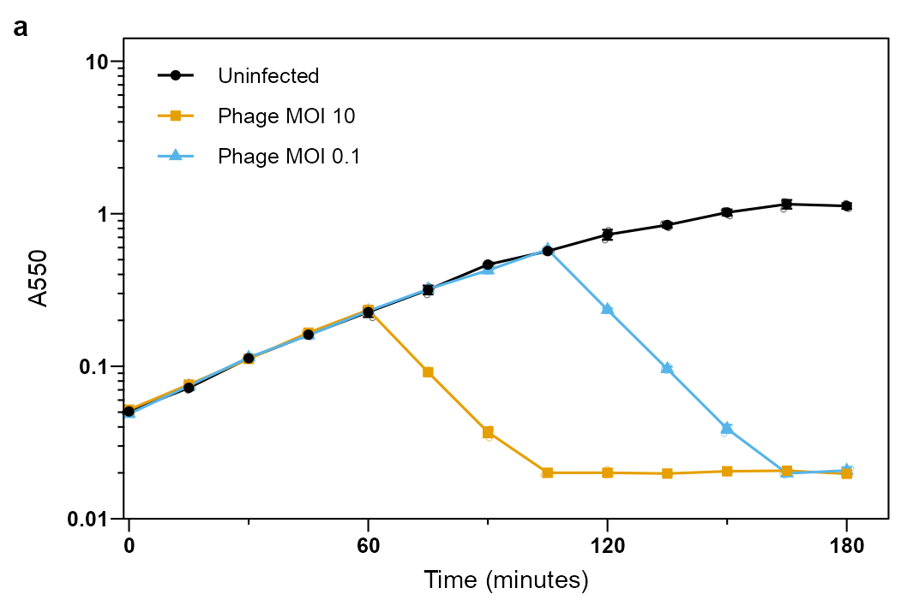
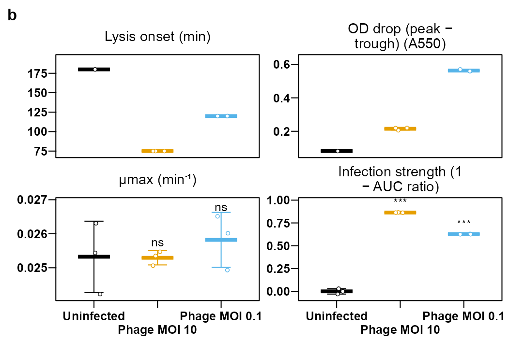

# How to label a figure

A tutorial for every kind of text the app can put on a lysis-curve figure: sample names and legend entries, axis titles, the title and subtitle, labels at the ends of lines, panel letters, labels on time markers and threshold lines, significance marks, point labels, and the figure legend (caption) that goes under the figure in the manuscript. It is organised by task. Control names are the labels shown in the app. The [user guide](USER_GUIDE.md) covers the rest of a session; the [figure standards](FIGURE_STANDARDS.md) say what journals expect of label sizes.

**One rule to keep in mind:** text on the artwork should identify what is drawn (which sample, which axis, which panel). Everything that explains the experiment (MOI, host, phage, medium, n, the error measure, the test) belongs in the figure legend text under the figure, not on the panel.

## A ten-minute walkthrough

Follow this once with the demo data; every later section is a reference you can come back to.

1. **Load the demo.** Pick **Lysis curve (3 samples)** beside **Load Demo Data**. The figure appears with three samples: Uninfected, Phage MOI 10 and Phage MOI 0.1.
2. **Rename a sample.** In the **Quick edit** strip under the figure, change the name of `Phage MOI 10` to `T4, MOI 10` and press Enter. The legend, every table and every report now use that name. The file's own column name stays the key, so the MOI is still read from it.
3. **Rename it on the figure instead.** With **Edit labels on the figure** ticked (it is by default), click the legend entry on the preview, type the name, press Apply. It writes into the same name box.
4. **Fix the axis titles.** In the strip, set **X-axis label:** to `Time (min)` and **Y-axis label:** to `OD600`. The y label is drawn as OD₆₀₀, and "min" tells every other figure and table that the times are minutes.
5. **Move the legend.** Set **Legend position:** to **Inside: emptiest corner (auto)**, then try **None** with **Show End-of-Line Labels** ticked under **Label Options**. Pick the one that reads better.
6. **Add a panel letter only if you need one.** Expand **Journal Figure Preset**, type `a` in **Panel label (optional):** and click **Apply journal preset**. Leave it empty for a single-panel figure.
7. **Mark the time of infection.** Expand **Time Point Markers**, tick **Enable Time Markers**, set **Time Point:** to the infection time, tick **Add Label** and type `+ phage`.
8. **Copy the caption.** Open **Figure Legend Text** in the sidebar and paste the drafted paragraph into the manuscript. Edit it there.
9. **Save the style.** Under **Save / Load Settings** click **Save Settings**. The names, labels and positions are all in the file.

## 1. Sample names and legend entries

The name of a sample is the text in its legend entry, and the app uses the same name in every figure, table, CSV file and report.

- **Where to type it.** The **name** box of the sample's row in the **Quick edit** strip under the figure, or click the legend entry on the figure (with **Edit labels on the figure** ticked) and press Apply or Enter; Esc drops the change.
- **What changes.** The legends and labels of every figure, the Statistics and Dashboard tables, every CSV download (which keep the file's own column name in a `sample_raw` column), the reports, the Figure Legend Text and the drafted methods text.
- **What does not change.** The file's column name stays the key: **Select Samples**, **Reference sample (infection metrics):** and the MOI box use it. The raw source-data CSV in the figure bundle keeps the file's names.
- **Saved with the settings.** **Save Settings** stores the name per sample as `legend_label`, so a settings file re-applies the names to a dataset with the same column names.
- **Order of the entries.** **Sample order (legend, panels, facets):** under **Figure Layout** is alphabetical by default; choose **As selected / as in the file** to keep the file's order (control first, then rising dose, for example).
- **Hide a sample without deleting it.** Untick **show** in its row of the strip, or click its legend entry and choose hide.

**Naming so the app can read the MOI.** The dose-response figure and the MOI metrics read the multiplicity of infection from the sample name. These forms are recognised, in either the column name or the display name: `Phage MOI 10`, `MOI=0.1`, `MOI: 5`, `moi_1e-2`. A sample without a positive MOI (the uninfected control) is left out of the dose-response. If the names cannot carry it, type `sample = MOI` lines in **MOI per sample (if not in the name):** on the Analysis figures tab, one sample per line or separated by semicolons, using the file's column name.

**Text formatting inside a name** (italic gene names, sub- and superscripts, bold) uses the markup described in [STYLING_AND_MARKUP.md](STYLING_AND_MARKUP.md) (v2.22 styling): `Δ*bshC*`, `A_{550}`, `10^{-7} PFU`. It is typeset on the figure and appears literally in tables and file names.

## 2. Axis titles and units

- **Where.** **X-axis label:** and **Y-axis label:** in the **Quick edit** strip, or click the axis title on the figure. (The sidebar's **Labels & Formatting** section reminds you they moved there.)
- **The x label sets the time unit everywhere.** The unit word in the x-axis label is read by the analysis figures, the metric axis labels, the dose-response axis and the captions: a label containing `min` gives minutes, `hour`, `(h)` or `hr` gives hours, `sec` gives seconds; anything else is reported as "time unit". Write `Time (min)` or `Time (h)`, and make it match the file. Times written as `H:MM:SS` are converted to minutes on load, so label the axis in minutes then.
- **Wavelength subscripts.** With **Typeset wavelength as subscript** ticked (**Labels & Formatting**; the journal preset ticks it), `A550` and `OD600` in the y label are drawn as A₅₅₀ and OD₆₀₀, also inside a longer label such as `A550 relative to Uninfected`. Untick it for plain text. The subscript digits are drawn at 70 % of the axis-title size, so at a 7 pt title they are 4.9 pt; set the title to 7.2 pt or more if the journal enforces a 5 pt floor, or leave the box unticked.
- **Style.** **Axis Label Size:**, **Axis Text Size:** (the tick numbers) and **Italic Axis Labels** are under **Labels & Formatting**. The journal preset sets 7 pt titles and 6 pt tick text. A converted wavelength label is always drawn upright, whatever the italic box says.
- **Tick labels.** **Y tick labels:** under **Figure Layout** chooses between `0.10`, `0.1` and powers of ten on the log axis. **X-axis Text Angle:** turns the tick numbers for crowded axes.

## 3. Title and subtitle

**Plot Title:** and **Plot Subtitle:** are under **Labels & Formatting**, with **Title Font Size:** and **Bold Title**. They can also be edited by clicking them on the figure. Both are empty by default, and for a journal figure they should stay empty: the panel letter identifies the panel and the legend text under the figure describes it. A title is useful on a slide or in a report.

## 4. Where the legend goes

**Legend position:** in the **Quick edit** strip offers the four sides outside the panel, the four inside corners, **Inside: emptiest corner (auto)** and **None**.

- **Inside: emptiest corner (auto)** is what the journal preset picks. It puts the key in the corner with the fewest plotted points and moves it outside, to the right, when there are more than four entries or every corner overlaps data.
- **Legend box border**, **Legend key size (mm; 0 = auto)** and **Legend Font Size:** adjust the key. **Figure Layout** also holds **Sample order (legend, panels, facets):**.
- **None** removes the key. Use it with end-of-line labels (section 5), or when the figure is one panel of a composed figure whose other panel already carries the key.

## 5. Labels at the ends of lines

Labelling each curve at its right end lets the reader follow a line without looking up a key, and it is the clearest choice for three to five samples.

1. Expand **Label Options** and tick **Show End-of-Line Labels**.
2. Set **Label Font Size (pt):** (match the legend size: 6 pt under the preset), **Bold Labels**, and **Label Offset (% x-axis):**, the gap between the line end and the label as a percentage of the x range.
3. Set **Legend position:** to **None** so the sample is not named twice.

The labels use the display names from the strip and repel each other, so curves that end close together get spread labels. With the fixed panel size the figure grows to the right to make room; check the size bar above the figure if the width is fixed by the journal.

## 6. Panel letters

A panel letter is drawn only when you type one. Four places set one, for four kinds of figure:

| Figure | Control | Where |
|---|---|---|
| Main lysis curve | **Panel label:** and **Panel label (pt):** | **Figure Layout**, and **Panel label (optional):** in **Journal Figure Preset** (the preset copies it in) |
| An analysis figure | **Panel label:** | the Analysis figures tab, next to **Figure:** (its default is `b`; clear it if the figure stands alone) |
| A composed multi-panel figure | **Add panel letters**, **Panel label size (pt):**, **Panel labels:** `a, b, c` or `A, B, C` | the Compose figure tab; the letters follow the panel order and replace the per-figure labels |
| Per-group panels of the main figure | the group names | the **Group** box per sample in **Variable Styling**; each panel's strip carries the group name |

The journal standard is an 8 pt bold letter at the top left, outside the panel. Nature journals use lower case and Cell Press upper case; check the target journal's figure guide. The exported file name carries the label (`lysis_curve_a_89x65mm.svg`), so two panels of one figure never overwrite each other.

## 7. Labels on time markers, threshold lines and regions

- **A vertical line at an event** (phage added, inducer, temperature shift): expand **Time Point Markers**, tick **Enable Time Markers**, set **Number of Markers:** and, for each marker, **Time Point:**, the line type, colour and width. Tick **Add Label** to write text beside it: **Label:**, **Size:**, **Position:** (Top, Middle or Bottom of the panel) and **H-Offset:** to nudge it left or right of the line.
- **A horizontal OD threshold** (the lysis threshold, a detection limit): tick **Show a horizontal threshold line (OD)** in the same section, set **Threshold (OD):** and type **Label (blank = none):**. The label sits at the right end of the line in the axis-text size.
- **A shaded region** (a growth phase, the infection window): **Region Highlighting** draws a filled rectangle between **X min:** / **X max:** and **Y min:** / **Y max:** with a fill colour and transparency. Regions carry no text; to name one, add a time marker with a label at the region's start, or describe it in the legend text.

Marker and threshold times are in the unit of the x axis. Keep marker labels short (`+ phage`, `37 → 42 °C`) and in the tick-text size, so they do not compete with the data.

## 8. Significance marks and statistical annotations

- **Stars on the metric summary.** On the Analysis figures tab, with **Reference sample (infection metrics):** set (Stats & Reports) and **Mark significance vs reference on the metric summary** ticked, each non-reference sample gets a mark above its points: `***` p < 0.001, `**` p < 0.01, `*` p < 0.05, `ns` not significant, Holm-adjusted across the comparisons with the method chosen under **Statistics:** (Welch t or Mann-Whitney). The mark is drawn only for comparisons against the reference; when the reference has no usable value for a metric (an uninfected control has no lysis onset) the app compares all pairs and draws no mark. The exact p values, the effect size and the confidence interval are in the Statistics tab and in the reports, and the legend text must state the test.
- **Asterisks on the separation figure.** **Separation from the reference** marks the times at which the replicates differ from the reference at Holm-adjusted p < 0.05; untick **Mark times with p (Holm) < 0.05 with \*** to hide them.
- **The error caption on the artwork.** **Annotate error type + n in caption** (**Error Bars / Shadow**) prints "Error bars: mean ± SEM (n = 3)" under the panel. It is on in the Legacy look and off under the journal preset, which puts that sentence in the Figure Legend Text instead; journals want it in the legend, not on the artwork.

## 9. Labelling points and datasets

- **Metric explorer.** Tick **Label the points with the sample names** to name every point of the one-metric-against-another figure; the labels repel each other.
- **Dose-response.** The x axis is the MOI read from the names (section 1), on a log scale. When every sample name carries an MOI the key is dropped, because the axis already says which point is which.
- **Comparing two datasets.** On the Compare tab, **Label, main data:** and **Label, second data:** name the two datasets in the key (overlay) or above the panels (facet).
- **Heatmaps.** The rows of the OD heatmap and the phenotype heatmap are the sample names; the colour key takes the y-axis label (with its subscript) or the metric name.

## 10. The figure legend (caption) text

Every journal figure needs a legend under it that says what was measured, how many replicates, what the error bars are, and the test behind any marks. The app drafts it:

1. Fill the **Experiment Notebook** fields that matter (host strain, phage, MOI, medium, temperature, replicate or batch).
2. Open **Figure Legend Text** in the sidebar. The paragraph is drafted from the current figure and the notebook: the measure (OD at the wavelength in the y label), the samples, n, the error statistic, the log axis, blank correction and the time window.
3. Copy it into the manuscript and edit it there. It is also written as `figure_legend.txt` in the figure bundle and the notebook download, and it appears under the figure in the HTML and PDF reports.

The text follows the current state of the figure, so draft it after the final settings. Markup in names is written as plain text with Unicode sub- and superscripts there.

## Checklist before you export

- [ ] Sample names read as the manuscript will call them, and every MOI sample has its MOI in the name or in the MOI box.
- [ ] The x-axis label carries the unit (`min` or `h`) and matches the file.
- [ ] The y-axis label names the measurement (`A550`, `OD600`) and the subscript looks right at the export size.
- [ ] Title and subtitle are empty for a journal figure.
- [ ] The legend is inside the panel or replaced by end-of-line labels, and no sample is named twice.
- [ ] The panel letter is set only when the figure has more than one panel, and its case matches the journal.
- [ ] Marker and threshold labels are short and in the tick-text size.
- [ ] The test behind any stars is stated in the Figure Legend Text.
- [ ] **Save Settings** has been clicked, so the labels can be re-applied to the next dataset.

## Common mistakes

| Symptom | Cause | Fix |
|---|---|---|
| Dose-response says no sample has a positive MOI | the names carry no readable MOI | rename as `Phage MOI 10` or fill **MOI per sample (if not in the name):** |
| Metric labels say "time unit" instead of min or h | the x-axis label has no unit word | write `Time (min)` or `Time (h)` |
| A sample is named twice on the figure | end-of-line labels and a legend both on | set **Legend position:** to **None** |
| The legend covers the curves | an inside position with many samples | **Inside: emptiest corner (auto)**, or an outside position |
| Panel letter `b` on a single analysis figure | the Analysis figures tab's **Panel label:** defaults to `b` | clear the box |
| Subscript digits flagged as too small | 70 % of a 7 pt title is 4.9 pt | title size 7.2 pt or more, or untick the subscript box |
| Renamed sample is not found by the reference or MOI box | those use the file's column name | pick the column name there; the display name is only for labels |
| Stars missing on the metric summary | no reference set, or the reference has no value for that metric | set **Reference sample (infection metrics):**; choose a metric the control has (peak OD, AUC) |

## Where to look next

- [User guide](USER_GUIDE.md): a whole session, from loading data to the reports.
- [Figure standards](FIGURE_STANDARDS.md): journal widths and text sizes, with sources.
- [Styling and markup](STYLING_AND_MARKUP.md): italic, bold, sub- and superscript markup in any figure text, direct labels and the matrix legend (v2.22 styling).
- [README](../README.md): installation and the full control list.
