# killcurveplot: the illustrated tutorial

This guide walks through the whole app, from opening it to a finished, journal-ready figure with its legend text,
statistics and report. Every picture was taken from the app itself (v2.26.0) with the built-in demo data or a
twelve-sample example file, so what you see here is what you will see on your screen.

You can read it straight through the first time (about 30 minutes, with the app open beside it), or jump to the part
you need:

1. [Start the app](#1-start-the-app)
2. [Load your data](#2-load-your-data)
3. [A tour of the screen](#3-a-tour-of-the-screen)
4. [Name, colour and style each sample](#4-name-colour-and-style-each-sample)
5. [Axes, scales and transforms](#5-axes-scales-and-transforms)
6. [Error bars, bands and replicate curves](#6-error-bars-bands-and-replicate-curves)
7. [The legend, and labels you place by hand](#7-the-legend-and-labels-you-place-by-hand)
8. [The legend text, the legend key and the colour map](#8-the-legend-text-the-legend-key-and-the-colour-map)
9. [One dataset, several panels](#9-one-dataset-several-panels)
10. [Journal size and the size bar](#10-journal-size-and-the-size-bar)
11. [Export: images, bundles and batches](#11-export-images-bundles-and-batches)
12. [Save, reload and reset your settings](#12-save-reload-and-reset-your-settings)
13. [The Data tab: check and edit the numbers](#13-the-data-tab-check-and-edit-the-numbers)
14. [Analysis figures](#14-analysis-figures)
15. [Compose a multi-figure layout](#15-compose-a-multi-figure-layout)
16. [Compare two datasets](#16-compare-two-datasets)
17. [Dashboard, Statistics and Curve fitting](#17-dashboard-statistics-and-curve-fitting)
18. [Notebook, reports and slides](#18-notebook-reports-and-slides)
19. [Help inside the app](#19-help-inside-the-app)
20. [Recipes](#20-recipes)
21. [Troubleshooting](#21-troubleshooting)

---

## 1. Start the app

**The easy way (no command line).** With [R](https://cran.r-project.org/) installed, double-click the launcher in the
app folder:

| Computer | Double-click |
|---|---|
| Windows | `Run Lysis Curve Plotter.bat` |
| macOS | `Run Lysis Curve Plotter.command` |
| Linux | `./run.sh` |

The first start installs the R packages the app needs (a few minutes); after that the app opens in your web browser
within seconds.

**From RStudio.** Open `Lysis_Curve_App_v28.R` and click **Run App** (green arrow, top right of the editor), then
**Open in Browser**. From a terminal, `Rscript run_app.R` does the same.

When the app opens, the figure area is empty and says how to begin:

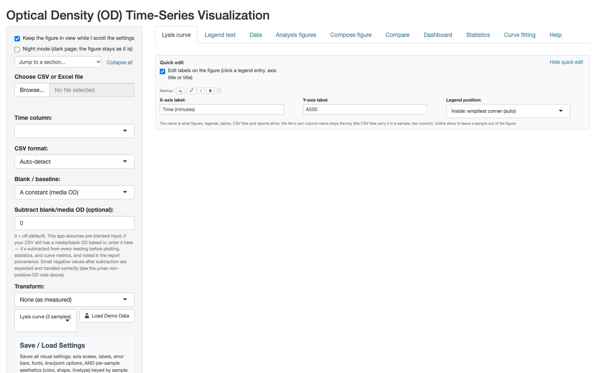

> **Tip.** The app keeps everything in your browser session. Nothing is uploaded anywhere; closing the tab ends the
> session. Use **Save project** (section 12) to keep the data and everything you did, or **Save Settings** to keep a style for next time.

---

## 2. Load your data

### Try the demo first

Click **Load Demo Data** (left column, under *Transform*). The menu beside it picks a demo: *Lysis curve (3 samples)*
is the one used throughout this guide. The figure appears at once, already in the journal standard (Nature single
column, Arial, 6 to 7 pt text):

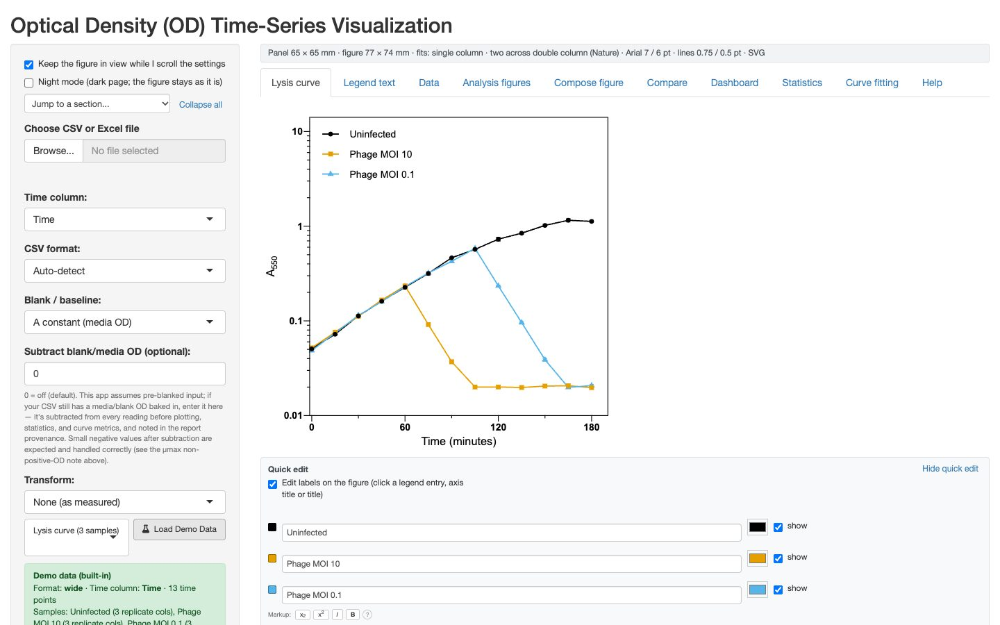

### Load your own file

Click **Browse...** under **Choose CSV or Excel file** and pick your file. The app reads:

* **Wide format** (most plate readers): the first column is time, then one column per well. Replicate wells share a
  column name (`MG1655, MG1655, MG1655, MG1655 + WT, ...`), and the app averages them.
* **Long format**: one row per reading, with columns for time, sample, value (and optionally replicate).
* Excel `.xlsx` / `.xls` (pick the sheet), decimal-comma and semicolon CSV files, instrument preambles, `HH:MM:SS`
  times, and stacked time blocks are all detected.

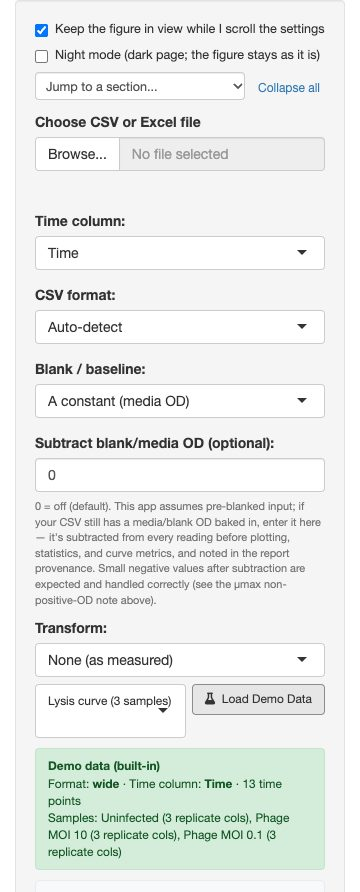

What each box does:

| Control | What it is for |
|---|---|
| **Time column** | Which column holds the time (guessed for you). |
| **CSV format** | *Auto-detect* is right for almost every file. |
| **Blank / baseline** | How the media blank is handled: a constant, or a blank sample in the file. |
| **Subtract blank/media OD** | A constant to subtract from every reading (0 = your data are already blanked). |
| **Transform** | Plot as measured, normalised to t = 0, relative to a control, % of each sample's maximum, or ln(OD). The y-axis title follows the transform. |

The green box under the demo button confirms what was read: the format, the time column, the number of time points and
each sample with its replicate count. Read it once for every new file.

---

## 3. A tour of the screen

* **Left column**: everything that changes the figure, in collapsible sections (*Axis Settings*, *Panels*,
  *Variable Styling*, *Plot Dimensions & Export* ...). **Jump to a section...** at the top opens one directly;
  **Collapse all** closes them. Only one section is open at a time.
* **Size bar** (above the tabs): the panel size, the figure size, whether it fits a journal column, the fonts, line
  weights and the export format. It turns yellow when the figure leaves the journal standard.

  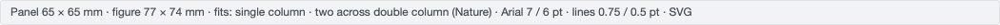

* **Tabs**: *Lysis curve* (the main figure), *Legend text*, *Data*, *Analysis figures*, *Compose figure*, *Compare*,
  *Dashboard*, *Statistics*, *Curve fitting* and *Help*.
* **Quick edit strip** (under the figure): the name, colour and *show* box of every sample, the axis titles and the
  legend position. This is the fastest way to label a figure.

  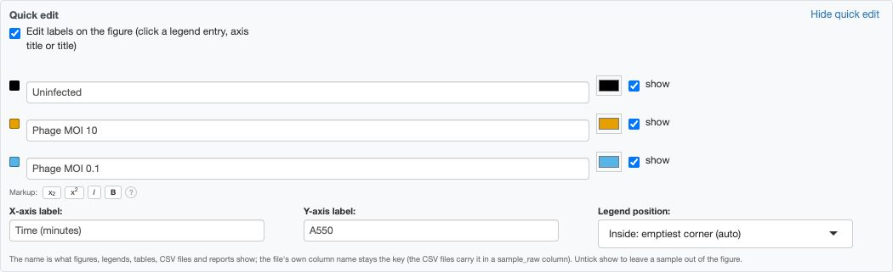

* **On the figure itself**: click a legend entry, an axis title or the title to rename it in place; drag the legend or a
  label to move it (section 7). Right-click the figure and choose **Copy Image** to paste it into a slide or document.

> **Keep the figure in view while I scroll the settings** (top of the left column) pins the figure so you can watch it
> change while you work far down the settings. **Night mode** darkens the page only; the figure stays as it will print.

---

## 4. Name, colour and style each sample

**Names.** Type the display name in the Quick edit strip. It is used in the figure, the legend, every table, the CSV
files and the reports; the file's own column name stays the key underneath. Markup works everywhere a name appears:
`*mltG*` is italic, `**bold**`, `A_{550}` subscript, `x^{2}` superscript.

**Hide a sample without deleting it.** Untick **show** in the strip, or remove it from **Select Samples** (Variable
Styling).

**Colour, marker, fill and line type.** Open **Variable Styling**. Each sample has its own block:

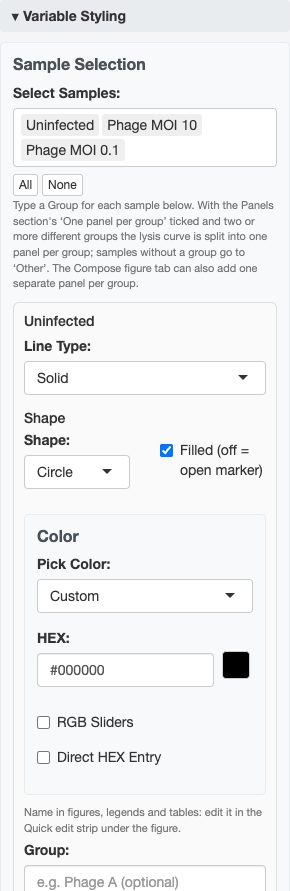

* **Line Type**: solid, dashed, dotted, dot-dash, long-dash, two-dash. A dashed line gets a longer legend key so the
  pattern is visible.
* **Shape** and **Filled (off = open marker)**: one marker shape per sample, drawn filled or open. The legend shows the
  same marker, filled or open, as the curve.
* **Color**: a named colour, a HEX code, RGB sliders, or the swatch in the Quick edit strip.
* **Group**: a free-text group (used by *Panels*, section 9).

### One colour scheme for a whole paper

A paper has several experiments and one set of colours: the empty vector is black in every figure, a given construct
is always the same orange. A **colour scheme** keeps that for you. Everything is in the Quick edit strip under the
figure:

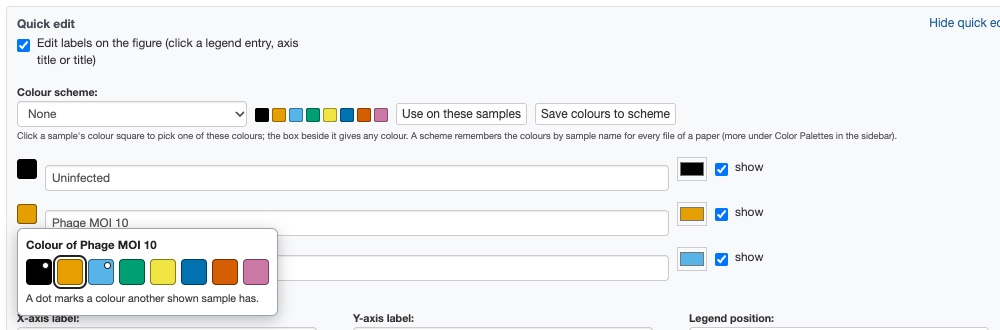

1. **Pick colours from the scheme, not from a colour wheel.** Click a sample's **colour square**. A small box opens
   with the scheme's colours (with no scheme chosen: the colours of the palette in use). A dot marks a colour another
   shown sample already has; the sample's own colour is ringed. One click sets it. The colour box beside the square
   still gives any colour at all. From the keyboard: Tab to the square, Enter, arrows, Enter; Escape closes.
2. **Save colours to scheme.** The first time it asks for a name (the paper's short title). The scheme keeps each
   sample's colour, marker, fill, line type and display name **by sample name**, and the colours in use as *the
   scheme's colours*.
3. **Load the next experiment.** With the scheme chosen in **Colour scheme:** it is applied by itself: samples it
   knows by name get their colours back (capitals and spacing do not matter: `ev` is `EV`), and samples it has never
   seen take its **next free colours**, so a new strain never borrows the colour of a strain from another figure.
   **Use on these samples** applies it again at any time (it also puts back a colour you changed by hand).
4. **Save colours to scheme** again: the new samples are **added** to the scheme. After a few files it knows every
   sample of the paper.

The same controls, and three more, are in the sidebar under **Color Palettes → Colour scheme for a paper**:

* **Colours of the scheme**: type or paste the paper's colours in order (`#000000, #E69F00, skyblue ...`) and save.
  With no data loaded this makes a scheme of those colours alone, ready before the first experiment.
* **Download scheme** / **Load a scheme file**: one small file to send to a co-author or carry to another computer.
  A loaded file never replaces a scheme of the same name that is already there (it comes in as "name (imported)").
* **Auto-apply on data load** (on by default) and **Delete scheme**.

A **project file** (section 12) carries its scheme with it: opening the project on another computer brings the scheme
along. With matched panels (section 9.7) a sample in a later panel is drawn in the colour of its match in the first
panel; the colour box says so when you open it for such a sample. Schemes saved as *themes* before v2.29 keep working
as they did (they style the names they know and nothing else) until they are saved again.

**Whole palettes** are under **Color Palettes** (the default is the colour-blind-safe Okabe-Ito set). **Line & Point
Settings** sets the line width, marker size and stroke for all samples, and **Hide lines** for points-only figures:

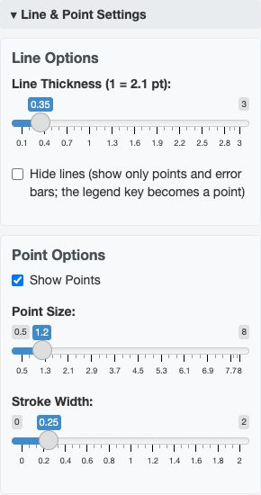

---

## 5. Axes, scales and transforms

Open **Axis Settings**:

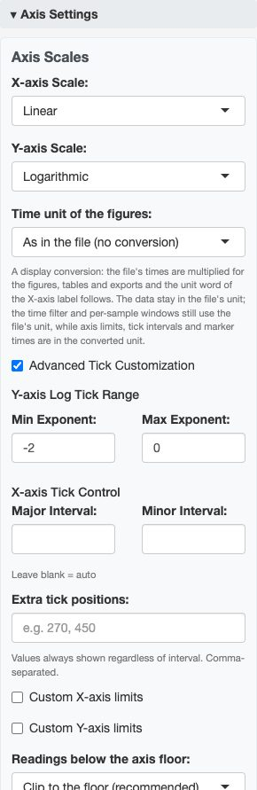

* **X / Y axis titles** (also in the Quick edit strip). The unit word in the x title (`min`, `h`) sets the time unit of
  every metric label. `A550` and `OD600` are typeset with subscripts automatically.
* **Y scale**: log10 (the default for OD) or linear. **Custom axis limits** and **tick intervals** for both axes.
* **Advanced ticks**: log decades and minor ticks. (The **axis frame**, box or L-shaped, is at the end of the **Panels** section.)
* **Figure Layout** (same section): legend box border, the sample order (legend, panels), the legend key size, the legend
  title and text style, and label wrapping.

**Transforms** (left column, top). For example *0-100 % of each sample's own maximum* puts every curve on the same
scale, on a linear axis with the title "A550 (% of maximum)":

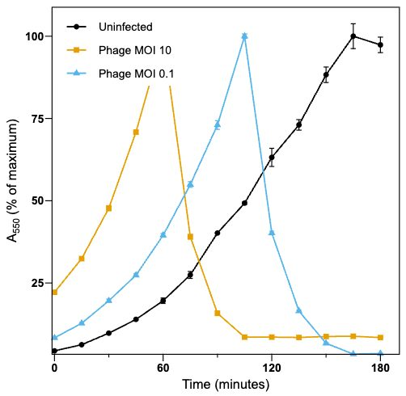

**Time Point Filtering**, **Region Highlighting** (a shaded time window) and **Time Point Markers** (a labelled vertical
line, e.g. "phage added") are their own sections.

---

## 6. Error bars, bands and replicate curves

Open **Error Bars / Shadow**:

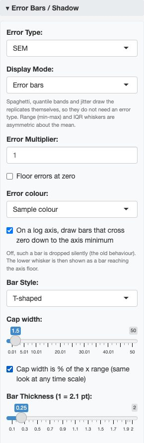

* **Error Type**: SD, SEM (default), 95 % CI, range (min-max) or IQR.
* **Display Mode**: error bars, a shaded band (*shadow*), the replicate curves themselves (*spaghetti*), quantile
  bands, jittered replicate points, or a combination.

| Shaded band | Replicate curves (spaghetti) |
|---|---|
|  | 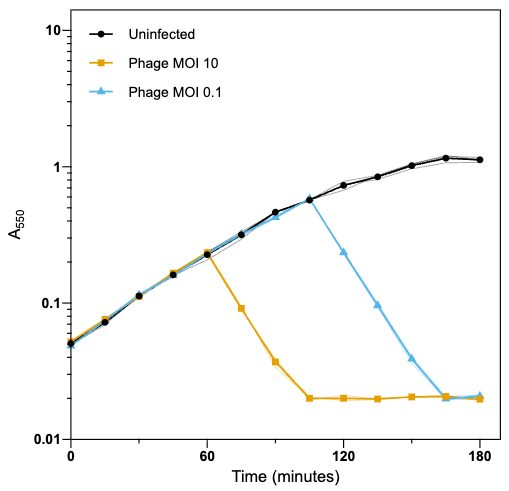 |

* **Error Multiplier** (e.g. 2 x SEM), **Floor errors at zero**, **Error colour**, **Bar Style** (T-shaped or plain),
  **Cap width** and **Bar Thickness**.
* On a log axis, a bar that would cross zero is drawn down to the axis minimum (it used to vanish).
* **Show bars shorter than the marker** (on by default, v2.28.1): a bar shorter than its marker used to lie entirely
  under it, cap included (in the journal look the marker is about 2.9 pt wide and the cap 2.6 pt), so points with tight
  replicates showed no bar. Such a bar now gets caps that reach 1 pt past the marker on each side, at the bar's true ends.
  Bars that were visible are drawn exactly as before. Switch it off for the old look.
* With *Readings below the axis floor: drop*, a bar whose mean is on the axis but one end runs past a limit is drawn up to
  the frame (it used to be deleted whole).

The legend text (section 8) always says which measure the bars show and the n behind it.

---

## 7. The legend, and labels you place by hand

**Legend position** is in the Quick edit strip:

* **Outside**: right, top, bottom, left. A long legend wraps into rows or columns instead of being cut off.
  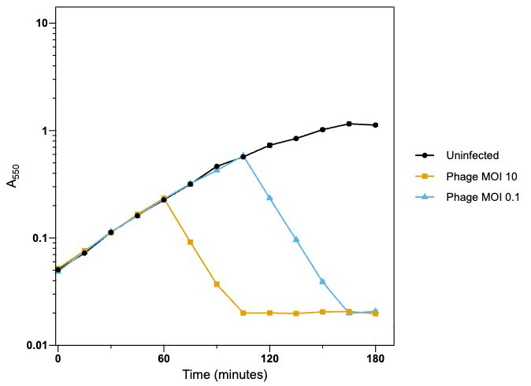
* **Inside**: a chosen corner, **the emptiest corner (auto)** (the default), or **custom**: drag the legend on the
  figure and drop it where you want it.
* **Direct labels at line ends**: each curve named at its right end, in its colour.
* **Floating labels (drag each name)**: every sample name becomes its own label in the sample's colour. Drag each one
  next to its curve; click a name (without dragging) to rename it. **Put the labels back** returns them to the starting
  column.
* **Matrix (grid) legend**: rows x columns, e.g. host x phage, set under Figure Layout.
* **None**.

**Extra labels on the figure** (Axis Settings > Figure Layout) adds free text, one label per line: a gene name, "lysis
onset", a strain. Each can be dragged into place, works with every legend position, and accepts the markup
(`*mltG*` is italic):

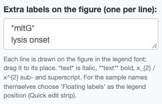

Floating sample names and two extra labels (*mltG* and "lysis onset"), each dragged into place:

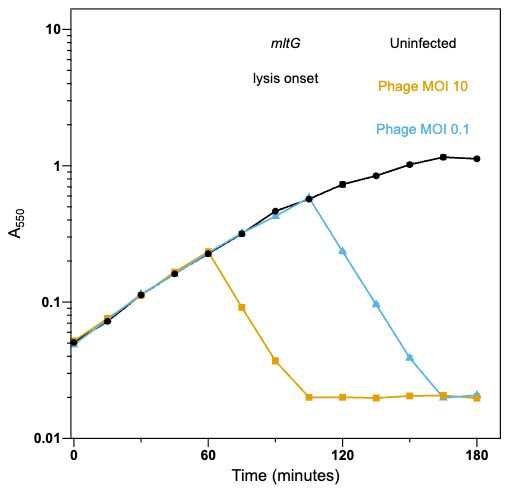

The dragged places are stored as fractions of the panel, so they hold at any size, on a log axis and in every export,
and **Save Settings** keeps them.

---

## 8. The legend text, the legend key and the colour map

Open the **Legend text** tab:

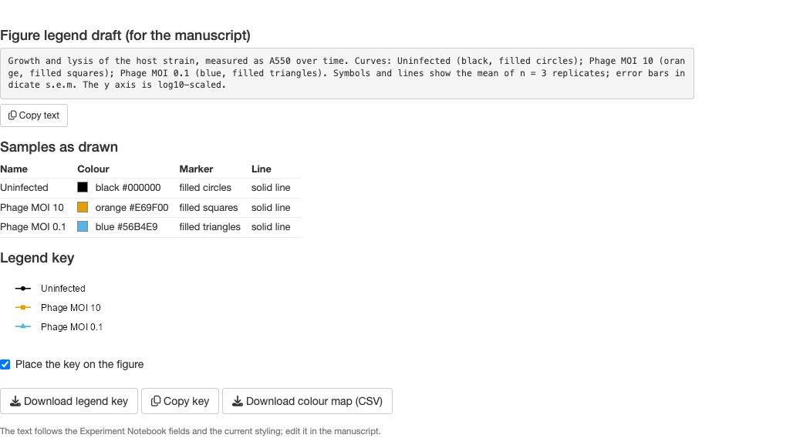

* **Figure legend draft**: a paragraph ready to paste under the figure in the manuscript: what was measured, each curve
  with its colour and marker in words, n, the error measure, the axis scale, blank correction. It follows the current
  settings and the **Experiment Notebook** fields (host strain, phage, MOI, medium, temperature). **Copy text** puts it
  on the clipboard.
* **Samples as drawn**: name, colour (word and HEX), marker and line for each sample.
* **Legend key**: the legend as a separate image, with each sample's exact colour, marker, fill and line type. **Download
  legend key** saves it in the export format; **Copy key** copies it. Every figure tab has its own *Download legend
  key*, and the figure bundle, *Download all figures* and the batch export include it.
* **Place the key on the figure**: one switch. Off = no legend on the figure (keep the key as a separate image); on = the
  legend comes back where it was.
* **The other figure tabs** (Analysis, Curve fitting, Compose, Compare) have the same: *Download legend key*, *Place the
  key on the figure* and a legend text starter for that figure, and Download all figures writes every figure's own key.
* **Download colour map (CSV)**: the colours as drawn (`"Sample","Hex","Colour_Name"`). **Load colour map** (Save / Load
  Settings) reads it back, so the same strain keeps the same colour across figures and projects.

---

## 9. One dataset, several panels

This is the part to read when one dataset should become a figure of several panels: one panel per phage with the
control in each, a set of panels lettered A, B, C, or the parts of one lettered panel.

For the pictures below, six samples of the twelve-sample example were selected (a control and five phages):

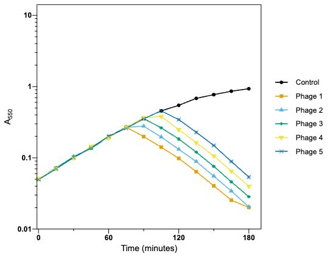

### 9.1 Split the figure

Open **Panels** and tick **Split the lysis curve into panels**. Then choose where each sample's panel comes from:

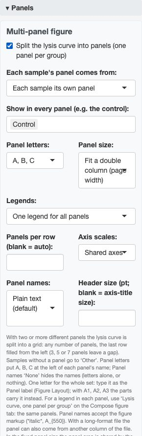

| Source | Use it when |
|---|---|
| **Each sample its own panel** | One panel per sample (the quickest). |
| **Pick the samples for each panel** | You decide: set the **Number of panels**, name each one, and pick its samples from a list. |
| **A panel name typed below** | Type a panel name next to each sample; samples with the same name share a panel. A sample in two panels: `A; B`. |
| **The Group typed in Variable Styling** | Your samples already have groups. |
| **Column of the file** | A long-format file with a column such as `strain` or `phage`. |

**Show in every panel** draws a sample (usually the control) in each panel, beside its treatment.

Each phage in its own panel with the control in every panel, letters A to E:

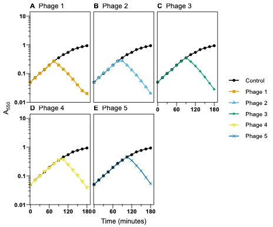

Any number of panels works. With 3, 5 or 7 the last row has a gap; **Panels per row** sets the grid (blank = automatic).
**Axis scales** can be shared (default) or free per panel.

### 9.2 Letters and names

* **Panel letters**: *A, B, C*, *a, b, c*, *1, 2, 3*, *i, ii, iii*, or *A1, A2, A3*. They are drawn in bold at the left
  of each panel's name.
* **Panel names**: plain, boxed, or **None**: with *None* only the letters show (or nothing at all, with letters off).

Letters only (names off):

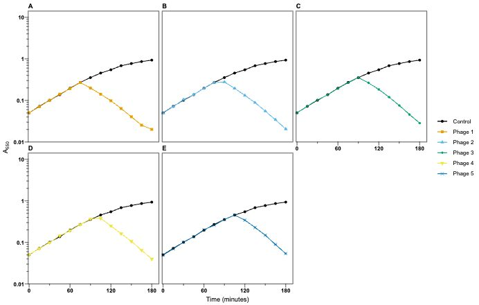

**One letter for the whole set.** When the whole multi-panel figure is itself panel A of a larger figure, type `A` as the
**Panel label** (Axis Settings > Figure Layout or Journal Figure Preset). It is drawn once, top-left, over parts
numbered 1, 2, 3 (or a, b, c):

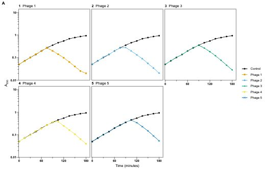

Or choose **A1, A2, A3**: each part carries the figure's letter, and the separate letter is not drawn:

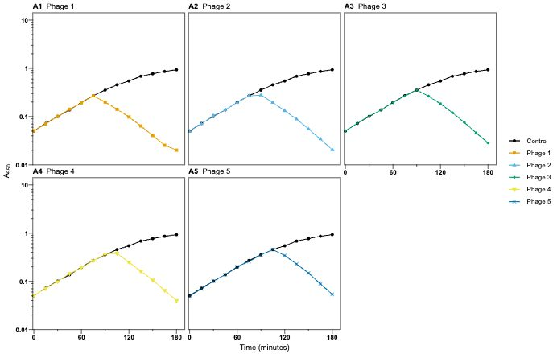

> **One rule for every multi-panel figure** (v2.27.3): the split lysis curve, Compare side by side, the analysis figures
> with several panels and the Compose tab all give each panel the size of a single figure's panel (all equal; the figure
> grows), with each legend inside a panel. Fit a double column below is there when the figure must be page width.

### 9.3 Fit the figure to the page

**Panel size** (since v2.27.2 the default is the first one: split a figure and every panel looks like a single figure):

* **Each panel at the full panel size** (default): every panel is exactly the size of a single figure's panel
  (65 x 65 mm in the journal standard), all panels the same, and the figure grows to hold them (the size bar says when
  it is wider than the page).
* **Share the panel area**: the figure keeps the size of one panel and the panels divide it (small panels).
* **Fit one column / 1.5 columns / a double column (page width)**: the whole figure is exactly that journal width
  (183 mm for a Nature double column), however many panels, and stays under the journal's maximum height. The size
  bar shows the panel count and one panel's size.

The same figure fitted to a double column:

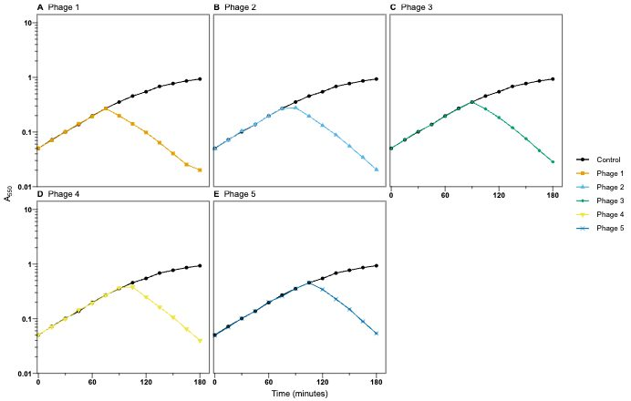

### 9.4 A legend in each panel, and each panel set on its own

**Legends: A legend in each panel** (the default since v2.27.2) makes every panel a figure of its own, each with its own
legend listing only its samples, laid out on the grid with the panel letters. With the legend position *Inside:
emptiest corner (auto)* each panel's legend always stays inside its panel, in the corner with the least data (measured
against the axis, so the empty part of a log axis counts as free). *One legend for all panels* puts a single legend
in the block of panels instead.

**Move a panel's legend by dragging it** (v2.27.4): each panel's legend has its own handle on the figure. Drop it where
you want it inside its panel (only that panel changes; its settings show *Inside: where dragged* with the x / y place),
or outside the panel to put it on that side.

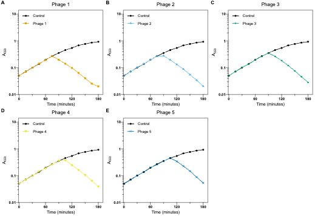

Under the menu, each panel then has its own settings block (click a panel's name to open it). Blank always means "as
the whole figure":

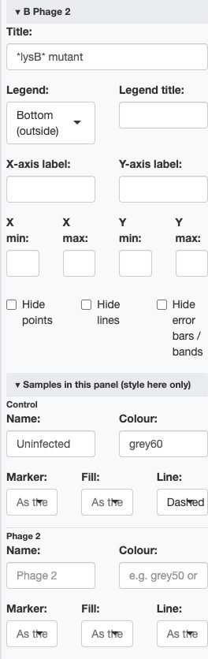

* **Title**, **Legend** place (outside right / top / bottom, an inside corner, none) and **Legend title**.
* **X-axis label**, **Y-axis label**, and **X / Y min and max** (zoom one panel on its own time window or OD range).
* **Hide points**, **Hide lines**, **Hide error bars / bands**: what this panel shows.
* **Samples in this panel (style here only)**: give a sample its own **name**, **colour**, **marker**, **fill** and
  **line type** in this panel only, e.g. the control as a grey dashed "Uninfected" curve in panel B.

Panel B with its own title (*lysB* mutant, italic), its legend at the bottom, and the control restyled as a grey dashed
"Uninfected" curve; the other panels are unchanged:

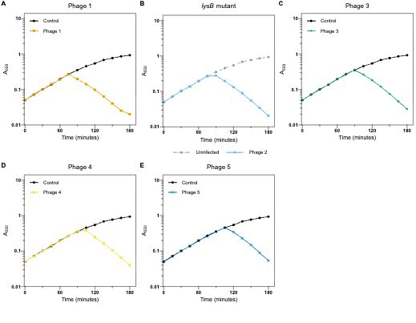

### 9.5 Pick the samples of each panel

With **Pick the samples for each panel**, set **Number of panels**, then give each panel a name and pick its samples.
A sample can be in several panels; a sample picked for none is left off the figure, its legend key and the legend text.

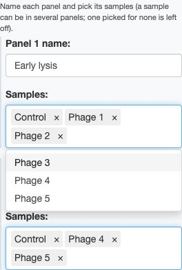

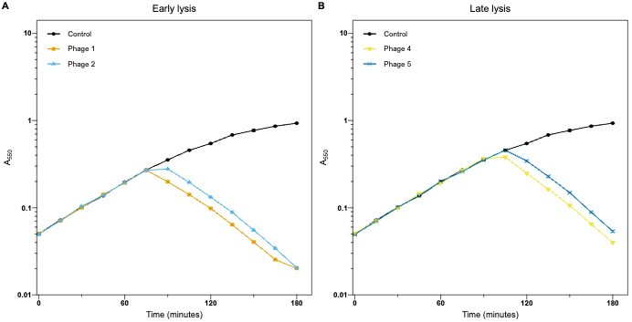

### 9.6 What the legend text and the key say

The **Legend text** tab adds a sentence naming what each panel holds, with the letters. A sample styled differently in a
panel is described in words there:

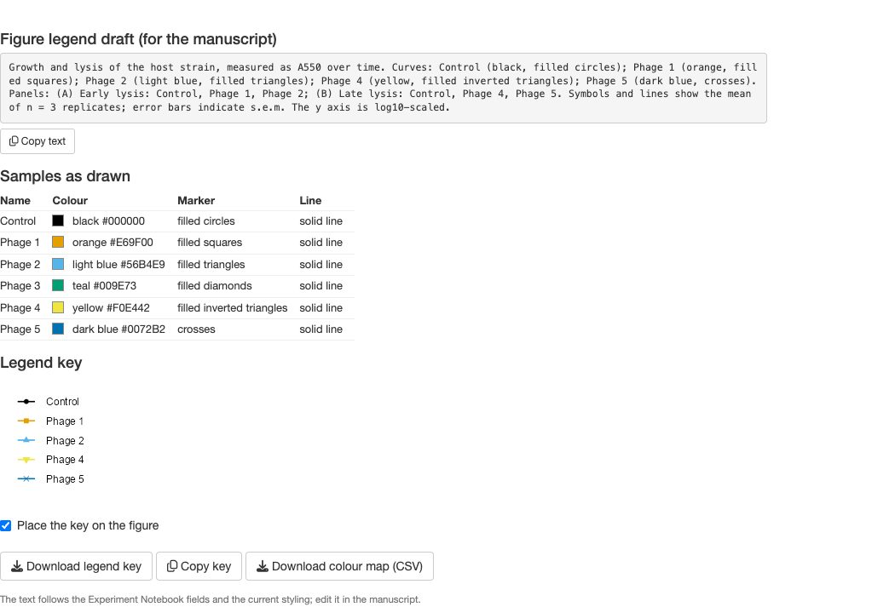

With *A legend in each panel* and a sample styled in a panel, **Download legend key** gives each panel's key under its
letter and name, so the key matches every panel. Everything here (the picks, the every-panel samples, each panel's
settings and sample styles) is kept by **Save Settings**, cleared by **Clear & Reset**.

> **The Compose figure tab** has *Lysis curve, one panel per group*: the same panels, with the Compose tab's own a, b, c
> letters, to combine with analysis figures (section 15).

---

### 9.7 Panels that look alike (sample styles across panels)

When every panel holds the same set of strains under a different condition (without and with a drug, uninfected and
infected), **Sample styles across panels** (Panels section) makes the panels match, so a reader can go from one panel to
the next without relearning the colours:

* **Same in every panel, line type changes by panel** (the default since v2.28.2): the first sample of every panel looks like the first sample of
  panel 1, the second like the second, and so on; panel 1 is drawn with solid lines, panel 2 dashed, panel 3 dotted.
* **Each sample its own style**: every sample keeps the colour and marker it has in the sidebar (the look before
  v2.28.2).
* **Same in every panel, markers filled / open by panel**: as above, with filled markers in panel 1 and open markers in
  panel 2 (crosses, X, plus and stars have no open form).
* **Same in every panel**: the panels are drawn alike and only their names tell them apart.

Samples are matched by their place in the panel (in the order they are listed), not by name, so "EV" and
"EV + drug" or "pRE" and "pRE_phage" pair up however they are named. Change a sample's colour or marker in the first
panel and the matching sample of every panel follows. A sample shown in every panel (a control) keeps its own style; with one curve per panel (*Each sample its own
panel*) there is nothing to pair, so every sample keeps its own colour. A panel's own sample styles (9.4) still apply on top. The sidebar and saved settings keep each sample's own style, so
switching back to *Each sample its own style* brings it back. The legends, the legend key and the legend text follow
what is drawn.

## 10. Journal size and the size bar

Open **Journal Figure Preset**:

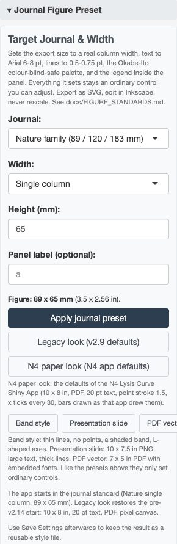

1. **Journal**: Nature, Cell Press, ASM, PLOS, Science, or a custom width.
2. **Width**: single column, 1.5 columns, double column, or half of a double column.
3. **Height (mm)** and an optional **Panel label**.
4. **Apply journal preset**: export size, Arial 6 to 8 pt, 0.5 to 0.75 pt lines, the colour-blind-safe palette and the
   legend inside the panel. Everything it sets stays an ordinary control you can change.

The app starts in this standard. **Legacy look** and **N4 paper look** restore older looks; **Band style**,
**Presentation slide** and **PDF vector** are one-click styles for other uses.

The panel itself has a fixed size (65 x 65 mm by default), and the figure is sized around it, so the plotting area is
identical in every figure you make. The size bar reports the result and whether it fits a column.

---

## 11. Export: images, bundles and batches

Open **Plot Dimensions & Export**:

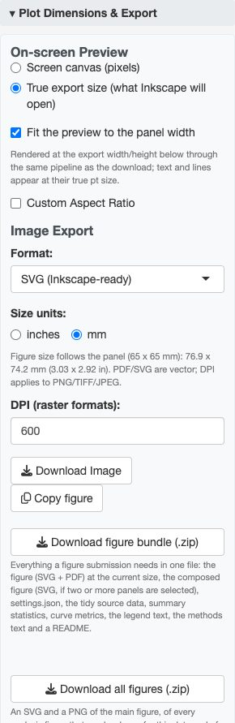

* **Format**: SVG (editable in Inkscape or Illustrator), PDF, PNG, TIFF (LZW) or JPEG. **DPI** applies to PNG, TIFF and
  JPEG (600 by default); the file records it.
* **Download Image**: the figure at its true size. The file name carries the size, e.g.
  `lysis_curve_main_77x74mm.svg`.
* **Copy figure** (or right-click the figure > **Copy Image**): paste straight into PowerPoint, Word or Slack.
* **Download figure bundle (.zip)**: everything a submission needs: the figure (SVG + PDF), the composed figure,
  the legend key, `settings.json`, the tidy source data, summary statistics, curve metrics, the legend text, the methods
  text and a README.
* **Download all figures (.zip)**: an SVG and a PNG of every figure the app can draw from your data, plus the legend
  key, the legend text and the methods.
* **Batch export** (same section): tick the outputs you want (figures, the legend key, CSV tables, notes) and one format
  and size for all.

**On-screen Preview**: *True export size* shows the figure exactly as it will print (recommended); *Fit the preview to
the panel width* scales it to the screen.

---

## 12. Save, reload and reset your settings

### Save the whole project (one file, no data upload next time)

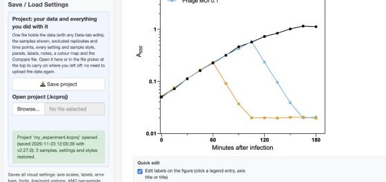

* **Save project** (top of *Save / Load Settings*, or the **Save the project** link under the file picker) writes one
  `.kcproj` file holding **the data and everything you did with it**: the data as loaded and as edited on the Data
  tab, the time column, the samples shown, excluded replicates and time points, the time filter, every setting and
  sample style (names, colours, markers, groups, panels and each panel's settings, label positions, notes), a loaded
  colour map and the Compare tab's second file.
* **Open project** (in the same box, or simply choose the `.kcproj` in the main **Choose CSV or Excel file** picker)
  restores all of it in one step: you do not upload the data again. A note says what was restored.
* The data stays inside the file exactly as it was (repeated replicate names, every digit), so **Revert to loaded**
  on the Data tab still goes back to the original numbers.
* Send a `.kcproj` to a colleague and they open the same figure, with the same data, in their copy of the app.

### Settings only

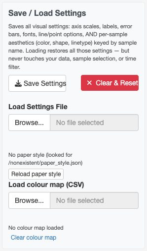

* **Save Settings** writes a `.json` file with every visual setting: axes, labels, error bars, fonts, legend, panels,
  dragged label positions, and each sample's colour, marker and line (by sample name).
* **Load Settings File** applies it to any dataset: samples with the same names get their styles back. Your data,
  sample selection and time filter are never touched. A settings file from the older lysis-curve-app also loads.
* **Clear & Reset** (asks first) returns everything to the journal standard.
* **Load colour map (CSV)** gives named samples fixed colours (see section 8).

> **Recipe.** Style one figure exactly as you want it, Save Settings, and load that file for every new experiment: the
> figures of a paper then match without any manual work.

---

## 13. The Data tab: check and edit the numbers

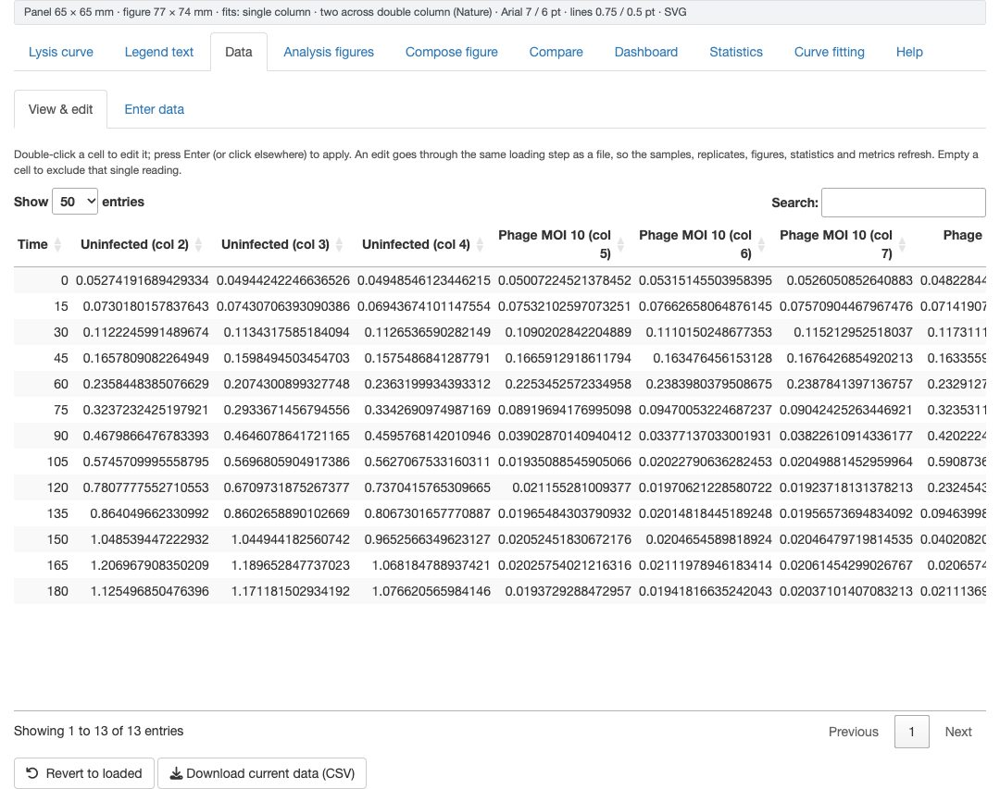

* **View & edit**: the data as loaded, one column per replicate. Double-click a cell to edit it, press Enter to apply;
  empty a cell to drop that single reading. Figures, statistics and metrics refresh at once. **Revert to loaded** undoes
  all edits; **Download current data (CSV)** saves the edited table.
* **Enter data**: paste or type a small dataset by hand.
* Replicates can be excluded (they stay visible as hollow grey circles when replicate points are shown, and no longer
  enter any mean).

---

## 14. Analysis figures

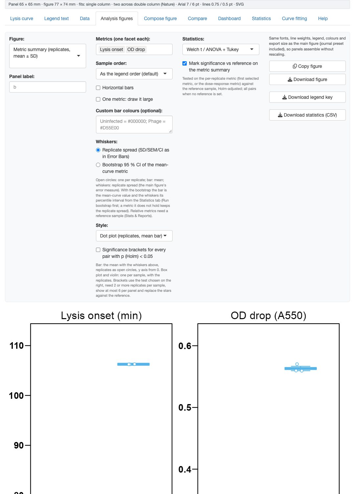

**Figure** chooses one of about twenty figures from the same data: the metric summary (replicates and mean per
sample), the specific growth rate, normalised OD, the separation from a reference, replicate overlays, curve landmarks
and phases, the MOI dose-response, heatmaps, the metric explorer, OD at chosen times, time to an OD threshold, the
fraction lysed, per-time comparisons, AUC and the rate of OD change.

They share the main figure's fonts, colours and size, so panels from here line up with the main figure. Each has
**Copy figure**, **Download figure**, **Download legend key** and **Download statistics (CSV)**. For the metric summary:
pick the **Metrics**, the **Statistics** test (Welch t / ANOVA + Tukey and others), significance marks against the
reference sample, the style (dot plot, bars, box, violin) and optional significance brackets.

---

## 15. Compose a multi-figure layout

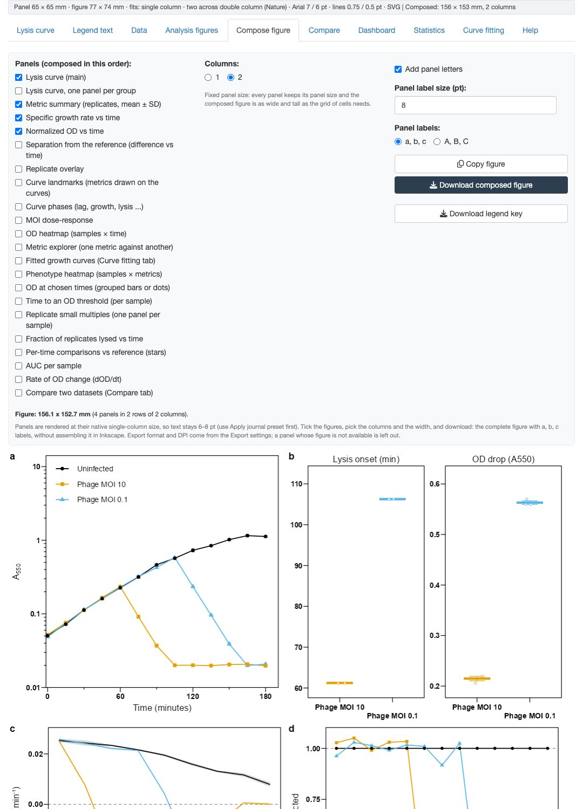

Tick the panels in the order you want them (the main curve, *one panel per group*, any analysis figure, the fitted
curves, the compare figure), pick 1 or 2 **Columns**, and **Download composed figure**. Each panel keeps its native
size, so text stays at 6 to 8 pt, and the panels are lettered a, b, c (or A, B, C) automatically.

---

## 16. Compare two datasets

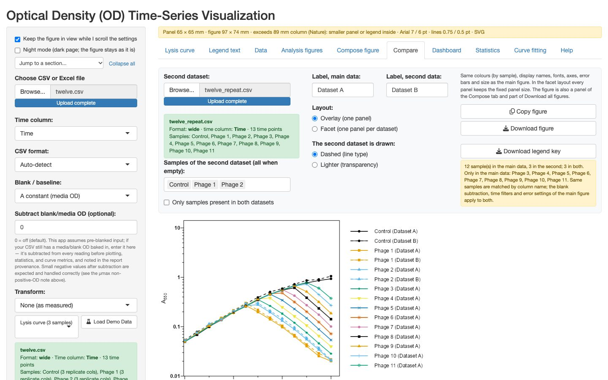

Load a **Second dataset** (e.g. a repeat experiment). Samples are matched by name; the yellow box lists which samples
are in one, the other or both. Draw them **Overlay** (one panel; the second dataset dashed or lighter) or **Facet** (one
panel per dataset), choose which samples of the second dataset to show, and name the two datasets. A second file with
no sample in common still draws (two different experiments).

---

## 17. Dashboard, Statistics and Curve fitting

**Dashboard**: four small figures at once (the lysis curve, the specific growth rate, normalised OD and the metric
summary), to see a dataset at a glance.

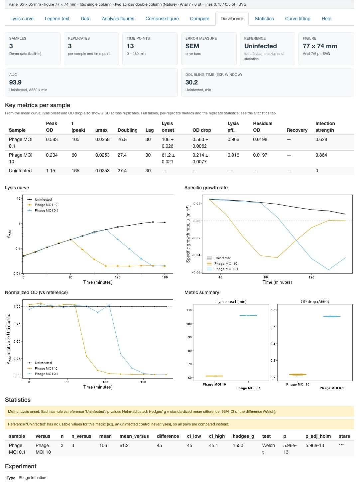

**Statistics**: everything the reports and CSV files contain, in one place: summary statistics per time point, curve
metrics (from the mean curve and per replicate), curve phases, replicate comparisons, OD at chosen times, time to a
threshold, the all-metrics comparison and bootstrap intervals. Each table downloads as CSV, and the **Methods**
paragraph for the reports is drafted and editable here.

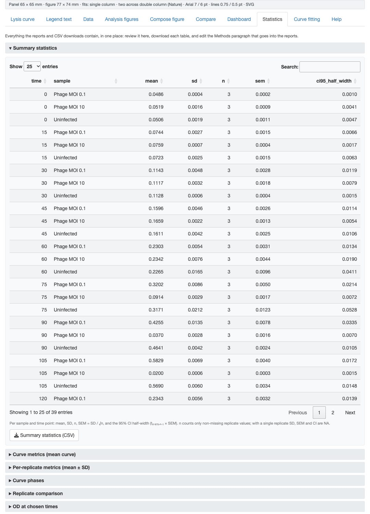

**Curve fitting**: logistic, Gompertz and Baranyi growth models fitted up to the peak (or the whole curve) on the mean
curve or each replicate, with the best model by AIC drawn, confidence or prediction bands, lysis-decay fits, the
exponential-growth window and parameter intervals. Fit warnings (too few points, poorly determined parameters) are
listed above the figure.

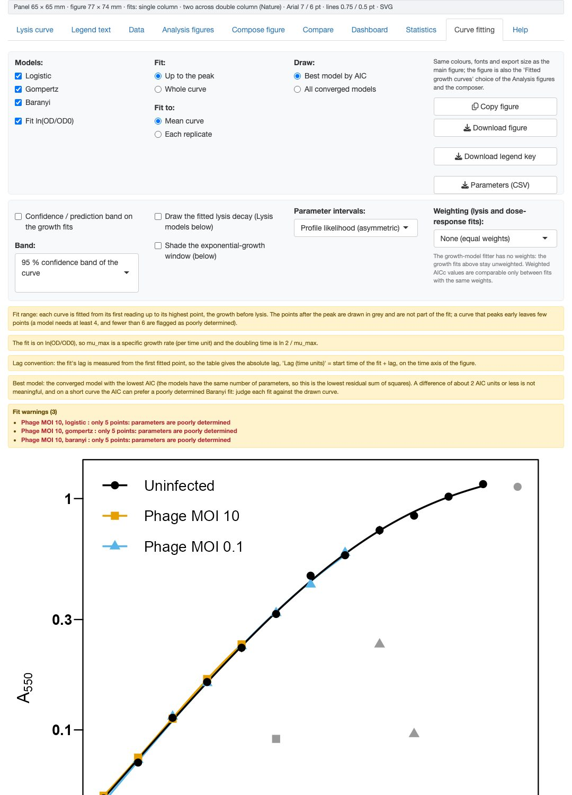

The full formulas and methods are in the *Metrics reference*, *Statistics reference* and *Fits and extraction* guides
(Help tab).

---

## 18. Notebook, reports and slides

**Experiment Notebook** records the experiment (ID, date, host strain, phage or plasmid, MOI, medium, temperature,
replicates). It feeds the legend text, the methods text and the reports, and downloads as text or a CSV row:

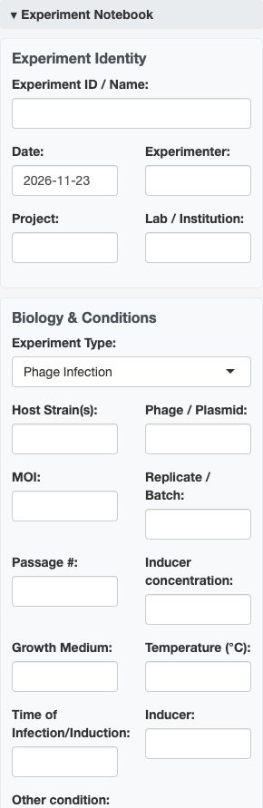

**Stats & Reports** downloads the statistics tables and builds the reports:

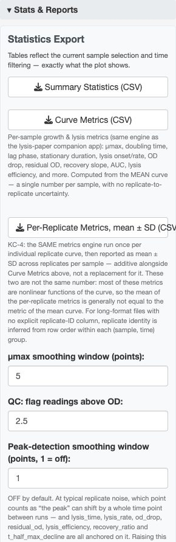

* **HTML Report (single file)** and **PDF Report (multi-page)**: the figure, the legend text, the statistics, the curve
  metrics, the methods and the data-quality flags.
* **Download PowerPoint (.pptx)**: editable vector figures, one curve added per slide (for talks).
* **Download Animated GIF**: the curves drawn over time.

---

## 19. Help inside the app

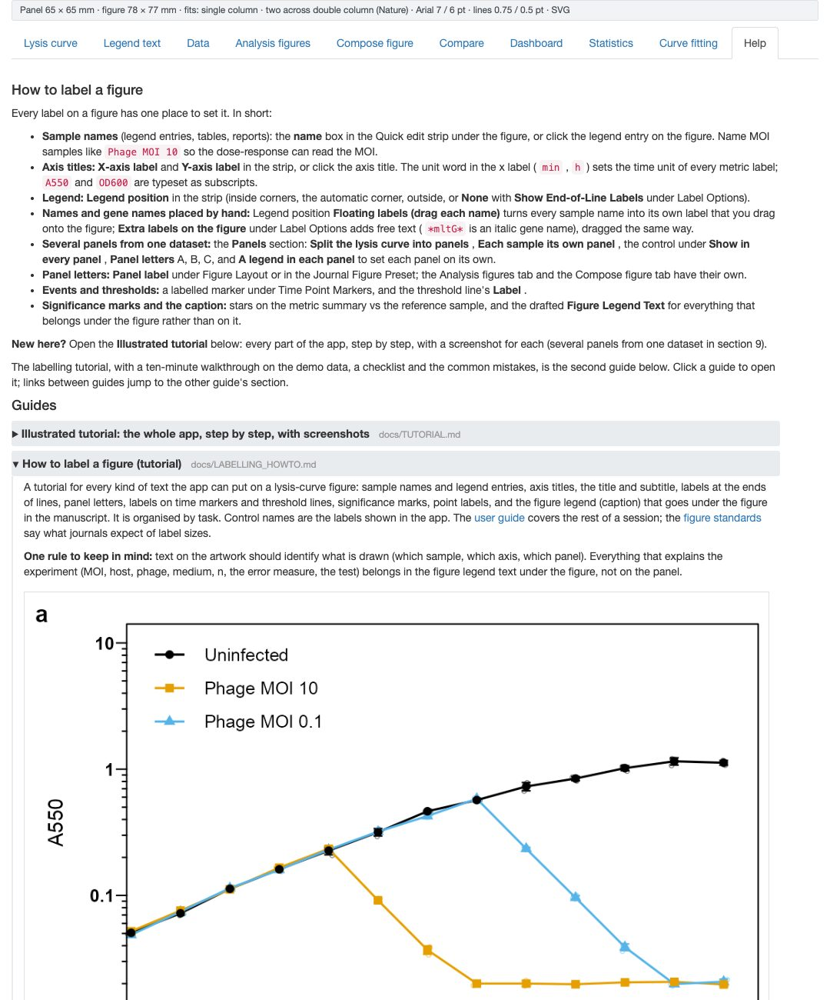

The **Help** tab holds a one-screen summary of where every label is set, and all the guides, this tutorial included
(click a guide to open it). Most controls also carry a one-line note under them.

---

## 20. Recipes

**A journal figure in five minutes.**
1. Load the file; check the green summary box.
2. Rename the samples in the Quick edit strip (markup for gene names: `*mltG*`).
3. Choose colours and markers (Variable Styling), or load your colour map.
4. Set the error measure (Error Bars / Shadow).
5. Download Image as SVG, and copy the legend text from the Legend text tab.

**One panel per phage, each with the control, for a full-page figure.**
1. Panels > tick *Split the lysis curve into panels*.
2. *Each sample its own panel*; *Show in every panel*: the control.
3. *Panel letters*: A, B, C; *Panel size*: Fit a double column.
4. Download Image. The legend text lists each panel's samples.

**Panels that each look different.**
1. As above, then *Legends*: A legend in each panel.
2. Open a panel's block below the menu: title, legend place, axis ranges, hide error bars...
3. *Samples in this panel*: restyle a sample in that panel only.

**The panels are panel A of a bigger figure.**
Type `A` as the Panel label and choose letters *1, 2, 3* (drawn as A, then 1, 2, 3), or choose *A1, A2, A3*.

**The same style for every experiment.**
Style once, Save Settings, then Load Settings File on each new dataset. For the colours, markers and names of the
samples, keep a colour scheme (section 4): it is applied by itself to every file you load.

**Figure + statistics for a paper.**
Download figure bundle (.zip): figure, legend key, legend text, methods, statistics and source data in one file.

---

## 21. Troubleshooting

| Problem | What to do |
|---|---|
| A sample is missing from the figure | Check *Select Samples* (Variable Styling), the *show* box in the strip, and, with *Pick the samples for each panel*, that it is picked for a panel. |
| Error bars are missing at some points | n = 1 at that time point (no spread); or the bar is shorter than the marker (keep *Show bars shorter than the marker* on, the default); or the bar fell below a log axis' floor (switch on *draw bars that cross zero*). |
| The figure is wider than the journal column | The size bar says so. Move the legend inside, shorten names, or for panels use *Panel size: Fit a double column*. |
| Text looks huge on screen | The preview shows the true print size scaled to the screen; the exported file is correct. Use *True export size* to check. |
| Two samples share a colour | Since v2.26.1 the palettes no longer repeat: samples past the eighth (twelfth for the default colours) get further distinct colours (purple, maroon, grey, olive, navy, magenta ...). Two samples that still look alike were most likely given the same colour by hand or by a colour map: set the colour in Variable Styling. Only Okabe-Ito's first eight colours are colour-blind safe, so with more samples give them different markers or line types too. |
| Floating labels or extra labels are not drawn | With *Split the lysis curve into panels* on, the ordinary legend is used; a note under the menu says so. |
| A settings file reports "wrong type" settings | Those values could not apply to a control (e.g. from a much older version); everything else was applied. |
| The app does not start | Run it once from RStudio to see the message; usually a package is missing: `install.packages("name")`. |

More detail for every control is in the [User guide](USER_GUIDE.md), the
[labelling tutorial](LABELLING_HOWTO.md), [Figure styling and markup](STYLING_AND_MARKUP.md),
[Data tab and transforms](DATA_TAB_AND_TRANSFORMS.md), [Compare, presets, exports](COMPARE_PRESETS_EXPORTS.md) and the
[README](../README.md).
